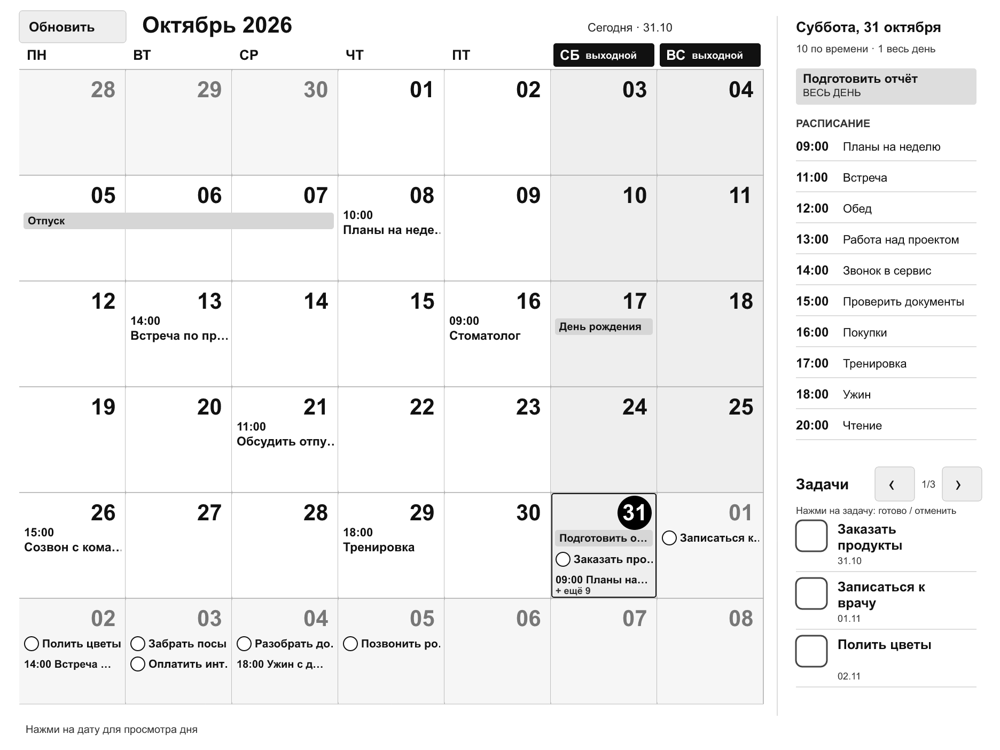

# Paper Calendar

Календарь и напоминания CalDAV на экране электронной книги. Читалку можно оставить в рамке: она показывает месяц, расписание выбранного дня и список задач, самостоятельно обновляя данные по Wi-Fi.

Написано на Rust. Нативный интерфейс PocketBook использует InkView и работает без постоянно включённого компьютера. Веб-просмотр позволяет запускать приложение на Mac или Linux и проверять интерфейс в браузере.



*На изображении — вымышленные события и задачи, без данных личного календаря.*

## Возможности

- Месячная сетка с крупными датами, выделением выходных, событиями на весь день и встречами со временем.
- Нажатие на день открывает его расписание справа; физические кнопки листания переключают месяцы.
- Расписание занимает от половины до трёх четвертей боковой панели. Оставшееся место используется для задач; доступны отдельные страницы списков.
- События со временем открывают описание, место и время встречи. Кнопка «Назад» возвращает список.
- Задачи с датой видны и в ячейке дня, и справа. Нажатие в любом из этих мест переключает выполнение.
- Выполненная задача сразу зачёркивается, через 30 секунд освобождает место в правом списке и остаётся отмеченной в календаре.
- Выполнение и отмена отправляются обратно в CalDAV. Без сети изменения сохраняются в очереди и переживают перезапуск.
- Через 30 секунд без действий интерфейс возвращается к текущему месяцу, сегодняшнему дню и началу списков.
- Автоматическое обновление раз в час и кнопка «Обновить». Если события и изображение не изменились, экран не перерисовывается.
- Частичные обновления e-ink, прямой вывод изображения из памяти, отключение Wi-Fi между синхронизациями и запрос сна после периода бездействия.

## Устройство

Проверено на **PocketBook InkPad 3 Pro / PB740-2**, в горизонтальной ориентации **1872 × 1404**. Сейчас размеры интерфейса фиксированы под этот экран. Другие модели, размеры и версии прошивки требуют отдельной проверки.

Сон и управление Wi-Fi зависят от прошивки. Время работы от аккумулятора не измерено; проект не обещает конкретное количество дней или недель автономности.

## Быстрый запуск

Требуются Rust 1.97.0, Cargo и установленный шрифт с кириллицей. Toolchain указан в `rust-toolchain.toml`.

```sh
git clone https://github.com/meshchaninov/paper-calendar.git
cd paper-calendar
cp config.example.json config.json
cargo run --locked -- --config config.json --demo
```

Откройте [localhost:8080](http://127.0.0.1:8080/). Деморежим использует вымышленные данные и не подключается к аккаунтам.

Пример конфига рассчитан на macOS. На Linux измените поля шрифта в полном `config.json`, например:

```json
"font_path": "/usr/share/fonts/truetype/dejavu/DejaVuSans.ttf",
"font_family": "DejaVu Sans"
```

## Подключение CalDAV

В `config.json` задайте часовой пояс и URL конкретных **коллекций календарей**, а не адрес веб-интерфейса сервера:

```json
"calendars": [
  {
    "name": "Личный",
    "url": "https://calendar.example.com/user/calendar-id/",
    "username_env": "CALDAV_USERNAME",
    "password_env": "CALDAV_PASSWORD",
    "tasks": true
  }
]
```

`tasks: true` включает чтение и запись напоминаний VTODO в коллекции. Для коллекции только с событиями оставьте `false`. Можно добавить несколько коллекций с разными переменными авторизации.

Пример запуска из zsh на macOS:

```sh
export CALDAV_USERNAME='your-user'
read -rs 'CALDAV_PASSWORD?Пароль приложения CalDAV: '
export CALDAV_PASSWORD
cargo run --locked -- --config config.json
unset CALDAV_PASSWORD
```

Для настоящего сервера не передавайте `--demo`. Предпочтительно использовать HTTPS и отдельный пароль приложения, если сервер его поддерживает.

Логин и пароль не записываются в JSON-конфиг или журнал. На читалке launcher может загружать их из локального `credentials.sh`; этот файл не входит в репозиторий. Сам кэш содержит личные события и также исключён из Git.

Веб-просмотр по умолчанию привязан к `127.0.0.1`. В нём нет отдельной авторизации: изменение `listen` на внешний адрес открывает изображение и управляющие HTTP-методы другим клиентам этой сети.

## PocketBook

Сборка, установка, подключение аккаунта и управление описаны в [инструкции для PocketBook](docs/pocketbook.md).

```sh
python3 -m venv .venv
. .venv/bin/activate
pip install cargo-zigbuild==0.24.0 ziglang==0.15.2
rustup target add armv7-unknown-linux-gnueabi
./scripts/build-pocketbook.sh
```

Скрипт собирает ARM soft-float бинарник и создаёт ZIP в `dist/`. Библиотека InkView берётся с устройства; SDK, системные шрифты и личные настройки в архив не включаются.

## Проверки

```sh
cargo fmt --all -- --check
cargo clippy --locked --all-targets --all-features -- -D warnings
cargo test --locked --all-features
cargo build --locked
python3 tests/smoke.py
python3 tests/task_sync.py
```

Интеграционные тесты используют только локальный временный CalDAV-сервер и вымышленные учётные данные. `smoke.py` проверяет интерфейс, кэш и таймеры; `task_sync.py` — выполнение, отмену, конфликт ETag, изменения во время отправки и очередь без сети. Для нестандартного расположения шрифта задайте `PAPER_CALENDAR_TEST_FONT`.

Отдельно выполнена проверка записи и отмены на Radicale с временным напоминанием. Это не заменяет проверку каждой модели читалки и каждого CalDAV-сервера.

## Устройство приложения

Данные приходят из CalDAV в локальный кэш, SVG преобразуется в изображение, а InkView обновляет только изменившиеся прямоугольники. На читалке при выключенном веб-просмотре промежуточный PNG не создаётся и не записывается на накопитель.

Напоминания сохраняются в устойчивой очереди. Перед отправкой приложение читает свежий ресурс, меняет поля выполнения и делает условный PUT с `If-Match`. При конфликте перечитывает ресурс, сохраняя чужие изменения заголовка, заметок, дат и будильников. Подробнее — в [описании архитектуры](docs/architecture.md).

## Ограничения

- Экран и расположение элементов рассчитаны на 1872 × 1404.
- Повторения VEVENT должны раскрываться сервером через CalDAV `expand`; нераскрытые серии не интерпретируются локально.
- Для повторяющихся VTODO нет поддержки изменения отдельных экземпляров. Приложение не заменяет серию целиком, чтобы отметить одно повторение.
- Создание, удаление и редактирование текста событий или задач через интерфейс пока не реализованы.
- Автоматического обнаружения аккаунта и входа в самом интерфейсе читалки нет: коллекции и учётные данные задаются в настройках.

Идея использования читалки как постоянного информационного экрана вдохновлена [Amber](https://github.com/nLight/amber).
